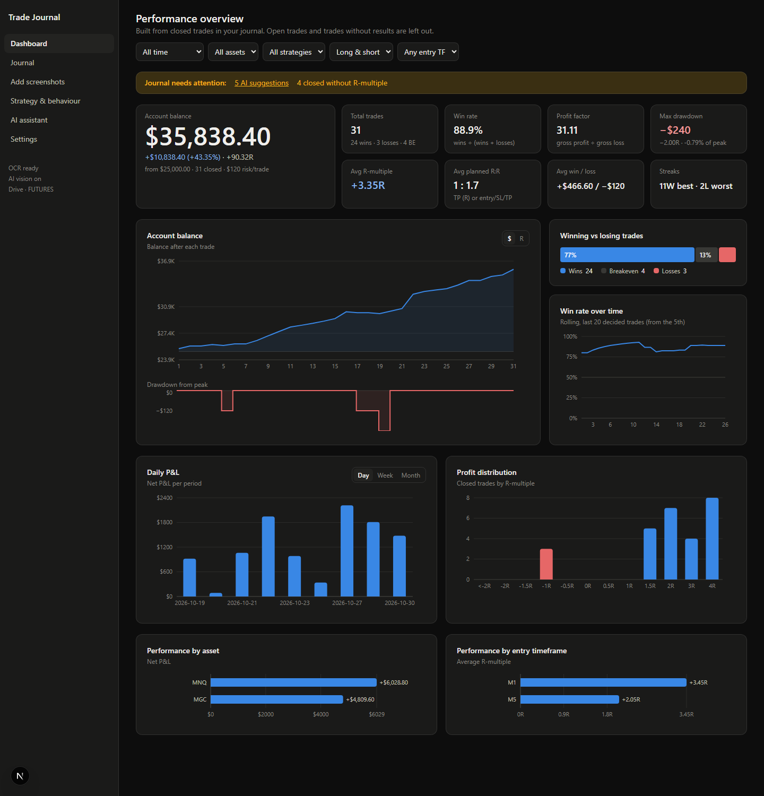
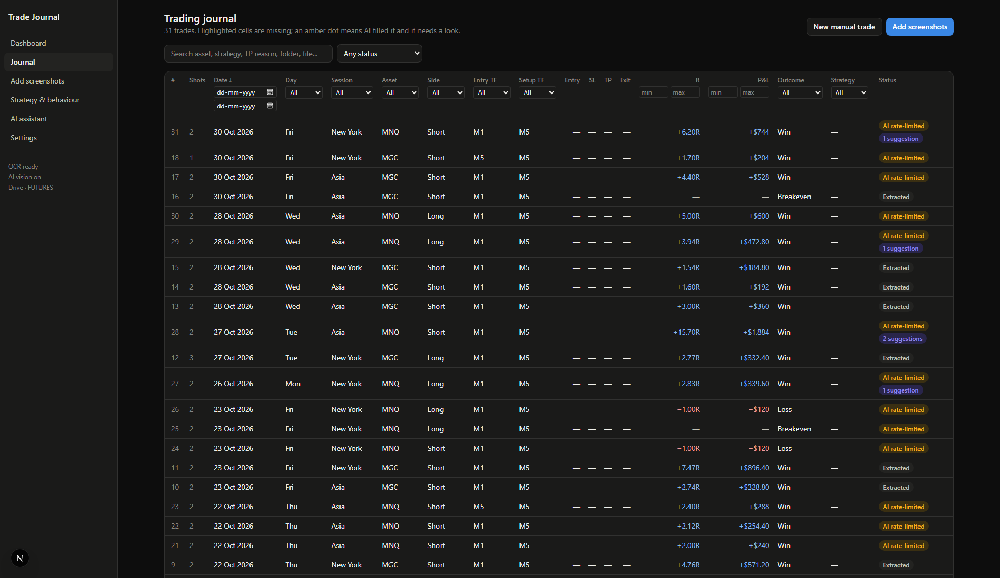
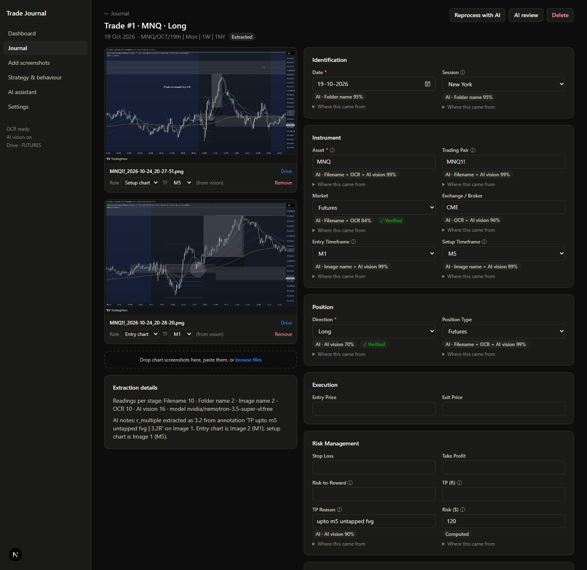
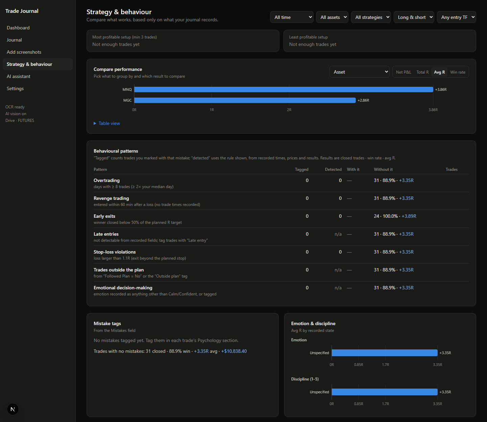

# EdgeLog — AI Trading Journal

AI-assisted trading journal: drop chart screenshots into Google Drive (or upload them), and the app reads
the trade from the filename, folder name, OCR, chart computer-vision and a vision LLM, then fills the journal,
flags what it is unsure about, and builds performance, strategy and behaviour analytics.

- `backend/` — FastAPI + SQLAlchemy (SQLite by default, PostgreSQL supported), extraction pipeline, Drive sync, AI assistant
- `frontend/` — Next.js + Tailwind + Recharts dashboard

## Screenshots

Taken from a real journal of MNQ and gold (MGC) futures trades, October 2026.

**Dashboard**: account balance, equity and drawdown, win rate, daily P&L, R distribution, results by asset and timeframe.



**Journal**: every trade with day, session, R and P&L; each column can be sorted and filtered.



**Trade detail**: the trade's M1 entry and M5 setup charts, and every field with where it came from (folder name, OCR, AI vision) and how sure the extraction was.



**Strategy & behaviour**: compare results by asset, session, setup or timeframe, and track behavioural patterns.



## Run it

**Backend** (Python 3.12):

```bash
cd backend
python -m venv .venv
.venv/Scripts/pip install -r requirements.txt      # macOS/Linux: .venv/bin/pip
cp .env.example .env                               # then put your OpenRouter key in .env
.venv/Scripts/python -m uvicorn app.main:app --reload --port 8000
```

**Frontend**:

```bash
cd frontend
npm install
npm run dev        # http://localhost:3000
```

Set `NEXT_PUBLIC_API_URL` if the backend isn't on `http://localhost:8000`.

## Configuration (`backend/.env`)

| Variable | Purpose |
|---|---|
| `OPENROUTER_API_KEY` | Enables the AI vision stage and the assistant. Without it, filename, OCR and chart-vision extraction still run. |
| `VISION_MODELS`, `ASSISTANT_MODELS` | Comma-separated OpenRouter model ids, tried in order. Default `qwen/qwen3-vl-8b-instruct` (paid, very cheap; it has no `:free` variant). Append `:free` models as fallbacks if you want. |
| `GOOGLE_CLIENT_ID`, `GOOGLE_CLIENT_SECRET`, `APP_SECRET_KEY` | Google Drive sync (read-only scope). Redirect URI: `http://localhost:8000/api/drive/auth/callback`. |
| `DATABASE_URL` | Defaults to SQLite in `backend/data/`. |

## How screenshots become trades

- Each Drive **subfolder** (or each upload batch) is one trade; its images are read together. An image named or
  detected as M1 is the entry chart, M5 the setup chart. "TP 2R" / "TP reason: …" are read from any of them.
- Instruments: MNQ/NQ and gold (XAUUSD/GC/MGC) are recognised from symbols, chart legends and price level.
- Every field gets a source and confidence: high → filled, medium → filled and flagged "Check this",
  low → offered as a suggestion. Values you typed or confirmed are never overwritten; reprocessing turns
  differing readings into suggestions. Every change is in the trade's history.

## Tests

```bash
cd backend && .venv/Scripts/python -m pytest -q
```

## License

All rights reserved. This code is shared for viewing only; it may not be used, copied or modified without permission. See [LICENSE](LICENSE).
